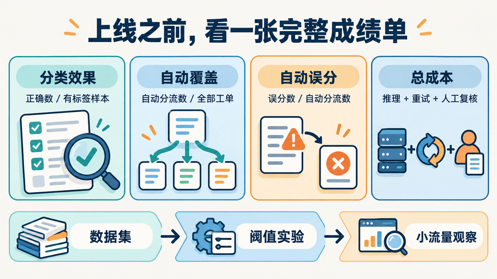

# Jev 值不值得上线：先算清效果、成本和失败代价

到这里，我们已经能够定义问题、读取答案，并把 Jev 放进工单系统或 Agent。但决定是否上线，还缺一张真实的成绩单。

演示能说明一条流程如何运转，业务采用则要回答另外的问题：它在哪些输入上可靠？减少了多少人工工作？失败时会付出什么代价？

## 先明确这次试点要改善什么

以系列里的客服场景为例，一个足够具体的试点目标可以是：“辅助分配账单、技术和销售工单，低把握情况保留人工分诊。”

这比“全面智能化客服”更容易评估。我们可以定义人工认可的首接团队，记录是否转派，统计从接收到进入正确队列的时间。

如果连标注员都经常对首接团队产生分歧，就应先修订规则。模型评测需要明确目标，否则所谓错误可能只是业务标准没有统一。

## 给模型准备一套会让它犯错的样本

以下是本文建议的试点评测结构，不是官方规定的样本量：先整理约 200 条脱敏样本，作为查找问题的小规模起点。它不足以证明很低的错误率，也不能代替后续生产观察。

样本除了常见工单，还应包括多诉求、否定、历史叙述、材料不足、中文反讽、领域缩写，以及嵌入指令的对抗内容。正常分布的数据用于估算日常表现，刻意收集的困难样本单独报告，避免混在一起让整体比例失真。

把样本分成调整用的数据与留出的验证数据。前一部分用来修改问题、标准和阈值；后一部分检查这些调整是否能推广到没反复看过的样本。对有分歧的标签进行复核，并记录标准为何改变。

官方当前说明英文效果最好，中文等语言需要自行验证。中文业务最好单独分层观察，不要拿英文 cookbook 的结果当作自己的成绩。[Models 语言说明](https://docs.typesafe.ai/models#language-support)

## 不只看总体准确率

对工单分流，我会同时记录下面这些指标。这里的表格是评测模板，数值全部留给真实实验填写。

| 指标 | 计算或记录方式 | 回答的问题 |
|---|---|---|
| 分类准确率 | 正确分类数 ÷ 有有效标签的样本数 | 分类本身表现如何 |
| 自动分流覆盖率 | 进入自动分流的工单数 ÷ 全部工单数 | 实际减少多少人工分诊 |
| 自动分流误分率 | 自动分流中错误的数量 ÷ 自动分流数量 | 自动处理部分是否可靠 |
| 各类别召回率 | 正确识别某类的数量 ÷ 该类真实数量 | 是否漏掉特定类别 |
| 人工复核负载 | 待复核数量与平均处理时间 | 人工队列是否承受得住 |
| 延迟与错误 | p50、p95、超时率、接口错误率 | 用户实际体验是否改善 |
| 单条总成本 | 推理、重试、后续处理与复核成本 | 节省是否真正发生 |

当自动分流数量为零时，误分率应标记为“不适用”，不能记为 0% 并宣传系统零错误。每项指标都应同时报告样本数，尤其是罕见类别。

<!-- jev-illustration:06 -->


*图：上线评估要同时查看分类效果、自动覆盖、自动误分和总成本；图中没有模型实测成绩。*

## 用一笔透明的账代替成本口号

截至 **2026-10-13**，官方模型页列出的 Jev 1.13 价格为每百万输入 token **0.042 美元**，输出 token 免费。[官方价格](https://docs.typesafe.ai/models)

假设一个请求实际记账的输入量平均为 2,000 token，那么教学估算如下：

```text
单次输入费用 = 2,000 ÷ 1,000,000 × 0.042
             = 0.000084 美元

100 万次同规模请求的输入费用 = 84 美元
```

这是按假设输入量与公开单价计算的示意，不是账单实测。实际输入量要看响应 usage 与服务计费记录，不能只数工单正文；问题、标准等也占用输入。

如果筛选失败导致后续重试，或者一部分请求仍要进入更昂贵的模型和人工流程，总成本还要加上这些环节。上线比较应在同一批样本、相近质量目标下进行。

合批可能减少重复材料和网络往返，但不能把某个官方实验的加速倍数直接套到自己的系统。尤其当不同阶段需要新的外部信息时，强行合并并不能消除数据依赖。

## 给版本与故障留一个可追查的记录

官方模型页说明，`jev-latest` 这样的别名会随发布移动，响应中的 `model` 则记录实际作答版本。若已经针对某个版本调整阈值，可以固定版本，并在升级前回放验证数据。[模型别名](https://docs.typesafe.ai/models#aliases)

在本文的试点方案里，一条判断记录至少应能关联问题配置版本、模型版本、答案、策略阈值、最终分支、延迟与接口状态。敏感原文按业务需要脱敏或使用受控引用，日志也不需要保存密钥。

同时预先定义超时与接口错误的处理方式：返回原有人工队列，或者使用经过验证的确定性规则。错误结果与“模型回答否”是两件不同的事，记录时应分开。

## 最后，决定是否扩大自动化

一个可操作的推进顺序是：先旁路记录建议，再开放少量可撤回的自动分流，观察一段时间后决定是否扩大覆盖。这里的推进节奏是作者建议，具体门槛需要结合业务错分成本和复核能力确定。

每次扩大范围，都应能够回答：新增覆盖的是哪一类输入？原有验证数据是否仍然通过？如果错误增加，怎样快速回到原来的流程？

基础篇走到这里，真正要交付的已经是一套清楚的判断流程：材料从哪里来，问题如何定义，什么结果会触发动作，什么时候复核，以及用什么证据证明它有价值。

如果要开始实践，就选一项频繁、范围有限、可以纠错的判断。把旧方案和 Jev 放到同一套数据上比较，再用结果决定下一步。

---

本文评测方案为作者建议，200 条样本与 2,000 token 为教学假设。价格和模型说明核对于 2026-10-13；没有在线准确率、时延或费用实测。

[系列目录](README.md) · [上一篇](05-把Jev接进Agent-从工具检查到文件筛选.md) · [下一篇：客服分诊实战](07-实战客服分诊-从分类到优先级.md) · [批量评测实例](10-实战批量评测-阈值预算与故障排查.md)
