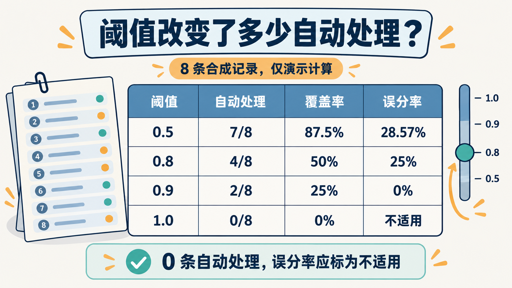

# 实战批量评测：从八条记录看懂阈值、预算与排错

一个分流器返回了合理标签，不等于已经适合处理整批业务。把它扩大到数百条、数千条记录时，新的问题才会出现：多少条需要人工？提高阈值后改善了什么？请求失败与模型误判如何区分？

这篇结合 `tutorial/` 第 8～11 章，提供一份可以运行的微型评测。所有预测都是手写数据，先用它看懂统计方法，再换成自己的真实结果。

## 八条记录，足以说明指标的区别

配套 [evaluation.csv](examples/evaluation.csv) 包含 `id,text,gold,predicted,confidence` 五列。`gold` 表示教学设定的人工标签，`predicted` 与 `confidence` 是构造的预测字段，不来自模型。

从仓库根目录运行：

```bash
python3 examples/run_examples.py evaluation
```

规则是：预测不是 `other`，且置信度达到阈值，才进入自动分流。得到以下离线计算结果：

| 阈值 | 自动处理数／总数 | 自动部分错误数 | 覆盖率 | 自动部分误分率 |
|---|---|---|---|---|
| 0.5 | 7／8 | 2 | 87.5% | 28.57% |
| 0.8 | 4／8 | 1 | 50% | 25% |
| 0.9 | 2／8 | 0 | 25% | 0% |
| 1.0 | 0／8 | 0 | 0% | 不适用 |

这个表演示了覆盖率与误分率的分母不同。在这组构造数据里，0.9 恰好没出错，但样本只有两条，不能因此称该门槛“完全可靠”。没有任何自动处理时，误分率也不能写成 0%。脚本用 `null` 表示不适用。

<!-- jev-illustration:10 -->


*图：八条合成记录的离线计算。零自动处理时误分率不适用，不能写成零错误率。*

## 换成真实预测，只替换数据

真实实验时，先由人工标注 `gold`，再从模型响应读取预测标签与置信度，保存到同样列名的 CSV。不要反过来拿模型输出当正确答案。

```bash
python3 examples/run_examples.py --csv /你的路径/results.csv
```

这个小工具只统计成功获得分类结果的记录。超时、限流、认证失败需另建运行记录；否则删掉所有失败行后算出的“覆盖率”，会误导读者以为整批任务都已处理。

每次实验还应关联问题版本、模型版本和数据版本。若中文业务包含口语、否定、反讽和中英混写，分别观察这些子集，比只看一个总分更容易找问题。

## 并发与预算，要分别设限制

`tutorial/` 的规模化章节有一个需要修正的公式：稳定负载下，粗略在途并发量可用“请求速率 × 平均延迟”估算，不能写成速率除以延迟。

例如，假设目标是每秒 20 个请求，平均耗时 0.3 秒，则粗略需要 6 个在途请求。这是教学算例，不是提供方配额。并发上限本身也不是限速器：请求突然变快时，同样的并发会发出更多请求。因此还需要独立的速率控制、token 预算和有上限的退避。

上下文预算同样不能只看一个数。官方模型页在 2026-10-14 列出总请求 64k token、`state` 加最长单个问题 32k token 两项约束。[Models](https://docs.typesafe.ai/models)

仓库某些示例按总量留出问题空间，使用约 60k 的 state 预算，并以字符数粗估 token；这些是本地实现选择，不能保证满足官方的 32k 约束，也不能直接推广为中文文本容量。新增文章没有沿用这种保证。

## 配置相似，不代表服务相同

本仓库 [client.ts](../apps/ten-levels/src/core/client.ts) 的内置后端是 `mock`、`typesafe` 和 `openrouter`。官方默认模型名为 `jev-latest`，OpenRouter 路径使用 `~typesafe/jev-latest`。这是当前本地源码配置，不能笼统说三家只换一个密钥就完全相同。

`tutorial/` 还介绍了 jev-ai.pro。该站明确说明自己提供独立兼容服务，账户密钥与目标地址需要配套；它的 Saved Judges、Web Context 等扩展应作为该服务能力理解，不能加进官方 API 请求就期待生效。[第三方服务文档](https://jev-ai.pro/docs)

对自媒体选题，第三方批量界面可以作为后续操作演示主题。但这组文章先用本地 CSV 演示指标，避免依赖账户、积分或不断变化的页面操作。付费方案、模型目录和效果对比需要发布前重新验证。

## 用一张排错表把问题分层

| 现象 | 先定位哪一层 | 下一步 |
|---|---|---|
| 401 或认证失败 | 密钥与目的服务 | 核对实际请求地址和对应账户，不打印密钥 |
| 请求验证失败 | 请求结构 | 检查必填字段、题型与候选，修输入后再试 |
| 429 | 流量控制 | 记录重试提示，检查请求速率与 token 消耗 |
| 200，但类别明显不对 | 材料与语义 | 核对实际 state、criteria、模型版本和概率分布 |
| 离线全通过，在线效果差 | 测试覆盖范围 | mock 只验证接线，另做带标签的语义评测 |
| 成本字段缺失 | 账务来源 | 标为 unknown；有配置单价时另标 estimated |

具体哪些状态可重试、总预算多少，应由实际客户端与提供方协议决定，不能把教程中一个客户端的行为写成所有 SDK 的默认规则。

成本记录也要区分实现。仓库通用客户端支持 reported、estimated、unknown、mock；Level 10 的教学账本则有缺成本时按固定单价估算的逻辑。后者不是所有后端账单的统一事实。

这套微型实验最后交付的，是一条可以复查的证据链：样本、标签、预测、阈值、动作、失败记录与成本来源。有了它，文章里的“有效”才能逐步变成读者可以检验的结论。

---

依据：[tutorial 第 8 章](../tutorial/08-规模化-并行-预算与成本.md)、[第 9 章](../tutorial/09-测试-生产化与运维.md)、[第 10 章](../tutorial/10-中文场景与jev-ai.pro扩展能力.md)、[第 11 章](../tutorial/11-故障排查与FAQ.md) 及本地代码。官方模型与第三方接口页核对于 2026-10-14；表中指标仅为合成数据的离线计算。

[系列目录](README.md) · [上一篇](09-实战Agent-何时压缩先读哪个文件.md) · [案例运行说明](examples/README.md)
