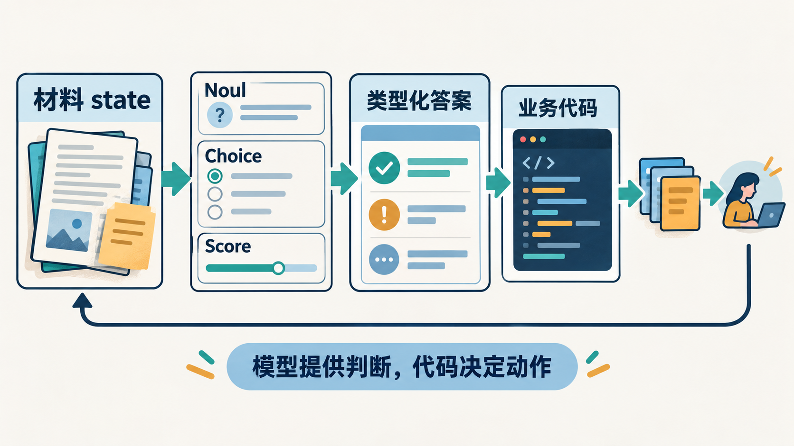
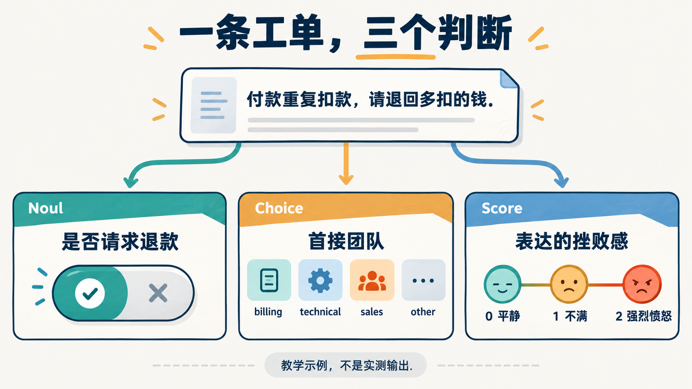
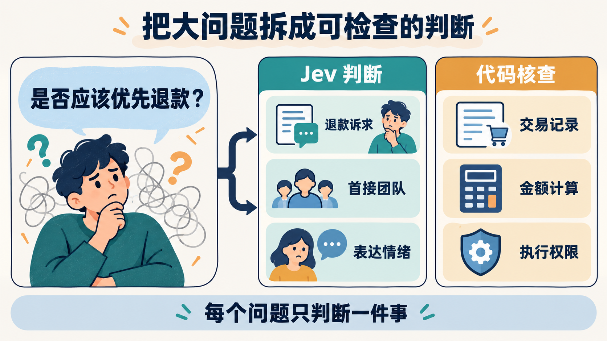
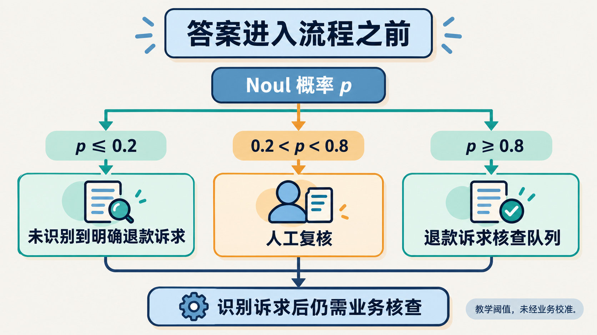
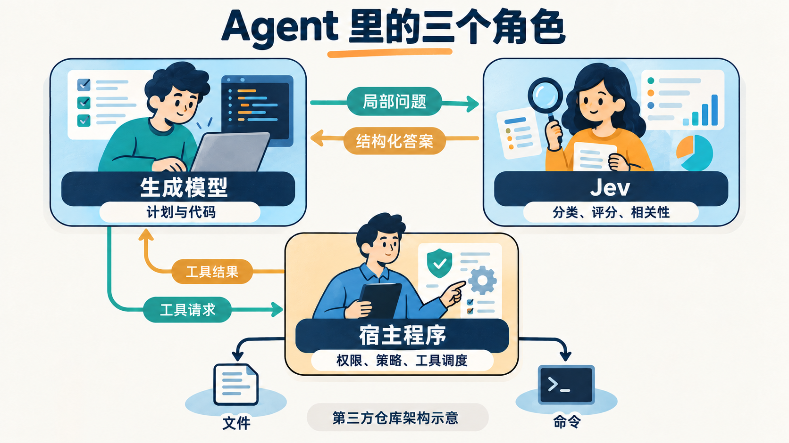
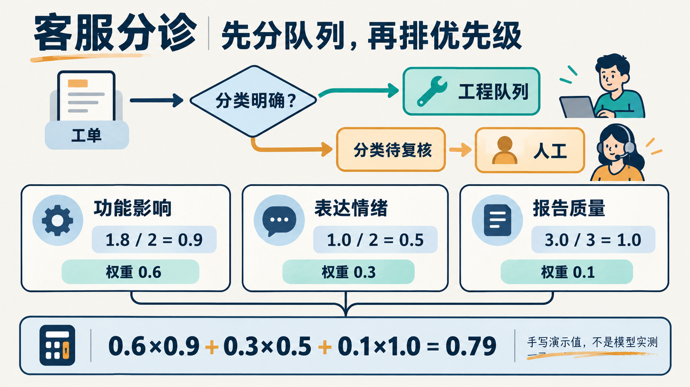
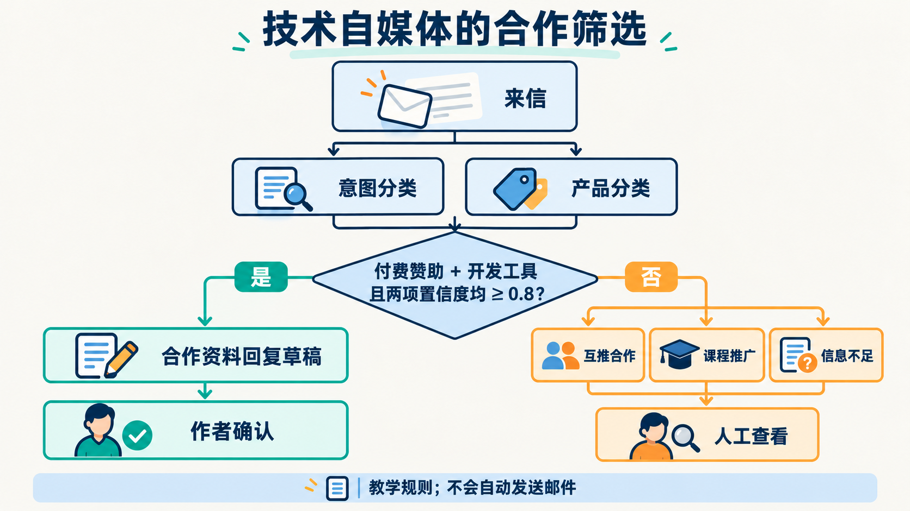
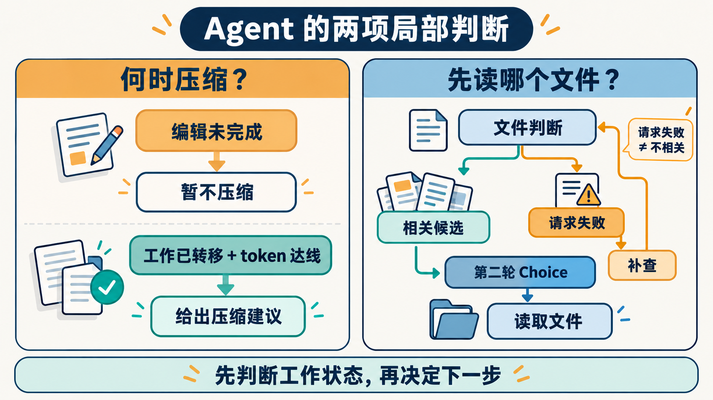

# Jev 系列配图索引

已完成并插入 10 篇文章，每篇 1 张核心图。使用 `baoyu-article-illustrator` 分析位置和构造提示词，使用 `imagegen` 的内置 `image_gen` 生成与校正。

统一浅色杂志图解风格，简体中文，16:9 横版，无水印。所有图片已复制到仓库；文章不依赖默认生成目录。

[配图大纲](outline.md) · [生成清单](manifest.json) · [系列文章](../../README.md) · [发布素材](../../发布素材清单.md)

## 图片与提示词

| 文章 | 最终配图 | 提示词 | 像素 |
|---|---|---|---|
| [01 Jev 是什么：当 AI 的答案要交给代码](../../01-Jev是什么-当AI的答案要交给代码.md) | [01-framework-decision-flow.png](01-framework-decision-flow.png) | [提示词](prompts/01-framework-decision-flow.md) | 1672×941 |
| [02 第一次调用 Jev：把一条工单变成三个判断](../../02-第一次调用Jev-把一条工单变成三个判断.md) | [02-infographic-three-primitives.png](02-infographic-three-primitives.png) | [提示词](prompts/02-infographic-three-primitives.md) | 1672×941 |
| [03 Jev 判断不准，先检查你给了什么、问了什么](../../03-Jev判断不准-先检查材料和问题.md) | [03-comparison-atomic-questions.png](03-comparison-atomic-questions.png) | [提示词](prompts/03-comparison-atomic-questions.md) | 1672×941 |
| [04 拿到答案以后：用置信度与代码搭起分流系统](../../04-拿到答案以后-置信度与分流系统.md) | [04-flowchart-confidence-routing.png](04-flowchart-confidence-routing.png) | [提示词](prompts/04-flowchart-confidence-routing.md) | 1672×941 |
| [05 把 Jev 接进 Agent：从工具检查到文件筛选](../../05-把Jev接进Agent-从工具检查到文件筛选.md) | [05-framework-agent-roles-v2.png](05-framework-agent-roles-v2.png) | [提示词](prompts/05-framework-revision-v2.md) | 1672×941 |
| [06 Jev 值不值得上线：先算清效果、成本和失败代价](../../06-Jev值不值得上线-效果成本与失败代价.md) | [06-infographic-evaluation-cost.png](06-infographic-evaluation-cost.png) | [提示词](prompts/06-infographic-evaluation-cost.md) | 1672×941 |
| [07 实战客服分诊：用 Jev 把消息变成队列与优先级](../../07-实战客服分诊-从分类到优先级.md) | [07-infographic-triage-score.png](07-infographic-triage-score.png) | [提示词](prompts/07-infographic-triage-score.md) | 1672×941 |
| [08 实战赞助邀约：给技术自媒体做一个合作筛选助手](../../08-实战赞助邀约-给自媒体做合作筛选.md) | [08-flowchart-sponsor-filter-v2.png](08-flowchart-sponsor-filter-v2.png) | [提示词](prompts/08-flowchart-revision-v2.md) | 1672×941 |
| [09 实战 Agent：何时压缩上下文，先读哪个文件](../../09-实战Agent-何时压缩先读哪个文件.md) | [09-comparison-compact-and-files-v2.png](09-comparison-compact-and-files-v2.png) | [提示词](prompts/09-comparison-revision-v2.md) | 1672×941 |
| [10 实战批量评测：从八条记录看懂阈值、预算与排错](../../10-实战批量评测-阈值预算与故障排查.md) | [10-infographic-threshold-table.png](10-infographic-threshold-table.png) | [提示词](prompts/10-infographic-threshold-table.md) | 1672×941 |

## 预览

### 01 · 一个面向软件的判断流程

材料、问题、类型化答案与业务代码各有职责，模型判断需要进入明确的程序分支。

### 02 · 退款工单的三种原语

同一工单可以同时提出是否退款、首接团队与挫败感三个问题。图中量表是教学定义。

### 03 · 从模糊问题到原子判断

把退款诉求、团队与情绪交给语义判断，把交易、金额与权限交给记录和代码核查。

### 04 · Noul 双阈值分流

双阈值把明确否定、待复核与核查队列分开。0.2 和 0.8 为教学阈值，正向判断不直接执行退款。

### 05 · 生成模型、判断器与执行器

生成模型发出局部问题和工具请求，Jev 返回结构化答案，宿主程序检查策略并调度工具。

### 06 · 评估效果、覆盖率与总成本

上线评估要同时查看分类效果、自动覆盖、自动误分和总成本；图中没有模型实测成绩。

### 07 · 四题工单判断与0.79计算

不同量表先归一化再加权，示例得到 0.79；分类与评分各自需要复核门槛。

### 08 · 赞助意图与产品分类

仅在“付费赞助 + 开发工具”且两项置信度达到教学门槛时建议生成回复草稿，仍由作者确认。

### 09 · 压缩时机与文件预筛

编辑中优先暂缓压缩；文件请求失败先补查，只有有效的相关候选进入第二轮选择。

### 10 · 8条合成数据的阈值对照

八条合成记录的离线计算。零自动处理时误分率不适用，不能写成零错误率。

## 制作记录

`source-01.md`～`source-10.md` 是插图前原文快照，用于核对文本；其中相对链接按原文章位置保留，不作为独立发布文档。`prompts/` 保存首次生成与校正提示词，`references/` 保存实际编辑参考。05、08、09 的初稿保留供比较，正文只引用 v2。

检查重点：题型字段、双阈值等号、0.79 加权计算、工具请求方向、赞助联合条件、文件失败补查、CSV 四行数据和零分母。配图不构成 Jev 准确率或成本实测。
